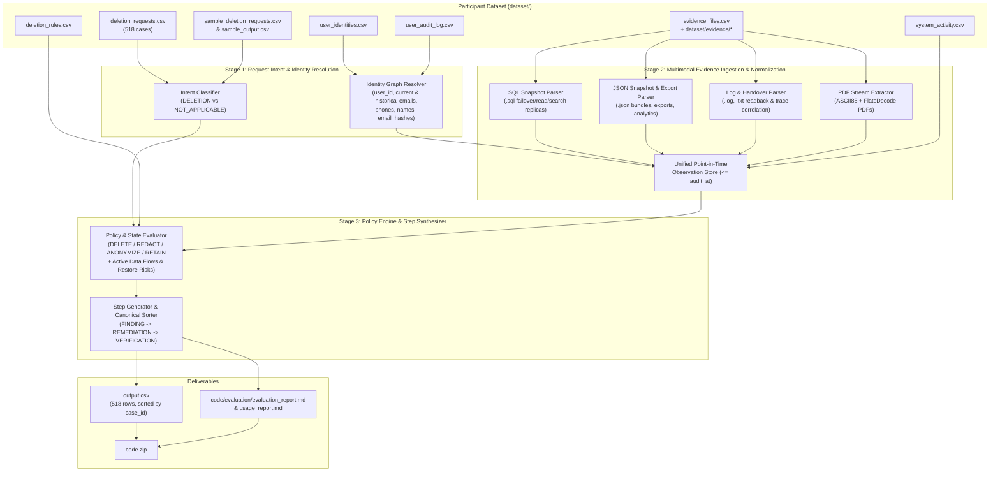

# Northstar Shop — AI-Powered Deletion Audit Agent

An end-to-end deletion audit and remediation planning engine for **Northstar Shop** 

Given customer requests in `dataset/deletion_requests.csv`, historical identity records (`user_identities.csv`, `user_audit_log.csv`), operational telemetry (`system_activity.csv`), data retention policies (`deletion_rules.csv`), and 94 heterogeneous evidence files (`dataset/evidence/`), this system determines:
1. Whether each request is **`COMPLETE`**, **`INCOMPLETE`**, or **`NOT_APPLICABLE`**;
2. Which remaining records, exposed PII fields, active synchronization flows, or restore risks violate policy at `audit_at`;
3. The ordered **`FINDING`**, **`REMEDIATION`**, and **`VERIFICATION`** steps (`steps_json`) required to remediate or prove compliance.

---

## 1. Setup Instructions

### Prerequisites
- **Python**: Python `3.10+` (uses only Python standard library modules: `csv`, `json`, `re`, `zlib`, `base64`, `pathlib`, `collections`; no external third-party packages or API keys are required at runtime).
- **Operating System**: macOS, Linux, or Windows.

### Environment Setup
1. Clone or navigate to the repository root:
   ```bash
   cd /Dev/Northstar_Delete_Agent
   ```
2. (Optional) Create and activate a virtual environment:
   ```bash
   python3 -m venv .venv
   source .venv/bin/activate
   ```
3. Verify that the participant-facing dataset exists under `dataset/`:
   - `dataset/deletion_requests.csv` (518 evaluation cases)
   - `dataset/sample_deletion_requests.csv` (32 sample cases)
   - `dataset/sample_output.csv` (32 sample ground-truth answers)
   - `dataset/user_identities.csv`
   - `dataset/user_audit_log.csv`
   - `dataset/system_activity.csv`
   - `dataset/deletion_rules.csv`
   - `dataset/evidence_files.csv` and `dataset/evidence/`

---

## 2. How to Run the Implementation

### 2.1 Generate `output.csv` for All 518 Requests
From the repository root, run:
```bash
python3 code/main.py
```
This reads `dataset/deletion_requests.csv` and writes `output.csv` at the repository root (`/Dev/Northstar_Delete_Agent/output.csv`) with:
- Exact header: `case_id,deletion_status,steps_json`
- Exactly **518 data rows** sorted ascending by `case_id`

### 2.2 Run the Evaluation Suite (`sample_output.csv` + Custom Cases)
To evaluate the implementation against the 32 sample cases in `dataset/sample_output.csv` and our 3 team-created evaluation cases:
```bash
python3 code/evaluation/main.py
```
Evaluation reports are located at:
- `code/evaluation/evaluation_report.md` (and `evaluation/evaluation_report.md`)
- `code/evaluation/usage_report.md`

### 2.3 Package Submission Archive (`code.zip`)
To create the submission archive `code.zip` at the repository root (excluding `dataset/`, virtual environments, and caches):
```bash
zip -r code.zip README.md code evaluation -x "*/__pycache__/*" "*/.venv/*" "*/venv/*" "*/node_modules/*" "*/.git/*" "*/.DS_Store"
```

---

## 3. Implementation Plan & System Architecture

### 3.1 Architecture Overview


### 3.2 Component Breakdown

#### Stage 1: Request Intent Classification & Historical Identity Resolution
1. **Intent Classification (`is_non_deletion_request`)**:
   - Inspects `request_text` for explicit non-deletion intent (e.g., *"unsubscribe me from marketing lists only and leave the account active"*, *"not asking for deletion"*, *"keep the account as it is"*, *"do not close the account"*).
   - When non-deletion intent is detected, the case immediately resolves to `deletion_status = NOT_APPLICABLE` with `steps_json = []`.
2. **Identity Graph Resolution (`load_identities`)**:
   - Links the request `email` to its canonical `user_id` across `user_identities.csv` (current state) and `user_audit_log.csv` (historical `old_value` / `new_value` transitions).
   - Builds per-user identifier sets: `{user_id, emails, phones, names, email_hashes}` so records referencing historical emails or phone numbers are accurately attributed while decoy emails in shared logs are ignored.

#### Stage 2: Evidence Ingestion & Trace Correlation (`parse_evidence_observations`)
All evidence files in `dataset/evidence_files.csv` are parsed into normalized resource observations filtered by `captured_at <= audit_at`:
- **SQL Captures (`.sql`)**: Parses `INSERT INTO` statements across `customer_account_failover_replica_capture`, `customer_search_primary_capture`, `customer_data_inventory_capture`, and `customer_data_read_replica_capture`.
- **JSON Exports & Bundles (`.json`)**: Parses `service_resource_export` (`service_exports`), `records_assurance_snapshot_bundle` (`snapshots`), `analytics_platform`, `export_service`, and `security_audit_service`.
- **Observability, Readback Logs & Shift Handover (`.log`, `.txt`)**: Parses `central_observability_export`, `service_readback_logs`, `support_replica.log`, and `customer_account_handover_20261001.txt`, correlating `trace_id` across `*_started` and `*_completed` log lines.
- **PDF Documents (`.pdf`)**: Decodes ReportLab `ASCII85Decode` + `FlateDecode` streams to extract structured support attachment and retention records (`delivery_correction_attachment.pdf`, `security_retention_extract.pdf`).

#### Stage 3: Policy Evaluation & Canonical Ordering (`audit_request`)
Applies `deletion_rules.csv` to each user's discovered resources at `audit_at`:

| System (`system_id`) | Category / Resource | Required Policy | Finding (if non-compliant) | Remediation | Verification |
| :--- | :--- | :--- | :--- | :--- | :--- |
| `account_service` | `account_*` (`USER_PROFILE`) | `DELETE` | `REPORT_REMAINING_RECORD` (`PRESENT`) | `DELETE_RECORD` (`ABSENT`) | `VERIFY_RECORD_ABSENT` (`ABSENT`) |
| `search_service` | `search_*` (`SEARCH_INDEX_ENTRY`) | `DELETE` | `REPORT_REMAINING_RECORD` (`PRESENT`) | `DELETE_RECORD` (`ABSENT`) | `VERIFY_RECORD_ABSENT` (`ABSENT`) |
| `export_service` | `export_*` (`USER_EXPORT`) | `DELETE` | `REPORT_REMAINING_RECORD` (`PRESENT`) | `DELETE_RECORD` (`ABSENT`) | `VERIFY_RECORD_ABSENT` (`ABSENT`) |
| `support_platform` | `support_*` (`SUPPORT_ATTACHMENT` / legacy index) | `DELETE` | `REPORT_REMAINING_RECORD` (`PRESENT`) | `DELETE_RECORD` (`ABSENT`) | `VERIFY_RECORD_ABSENT` (`ABSENT`) |
| `support_platform` | `support_*` (`SUPPORT_MESSAGE`) | `REDACT` | `REPORT_EXPOSED_PII` (`PRESENT`) | `REDACT_RECORD` (`REDACTED`) | `VERIFY_RECORD_REDACTED` (`REDACTED`) |
| `analytics_platform` | `analytics_*` (`ANALYTICS_PROFILE`) | `ANONYMIZE` | `REPORT_EXPOSED_PII` (`PRESENT`) | `ANONYMIZE_RECORD` (`ANONYMIZED`) | `VERIFY_RECORD_ANONYMIZED` (`ANONYMIZED`) |
| `analytics_platform` | `analytics_*` (`SECONDARY_IDENTIFIER`) | `DELETE` | `REPORT_REMAINING_RECORD` (`PRESENT`) | `DELETE_RECORD` (`ABSENT`) | `VERIFY_RECORD_ABSENT` (`ABSENT`) |
| `identity_service` | `tombstone_*` (`ACCOUNT_TOMBSTONE`) | `REDACT` | `REPORT_EXPOSED_PII` (`PRESENT`) | `REDACT_RECORD` (`REDACTED`) | `VERIFY_RECORD_REDACTED` (`REDACTED`) |
| `security_service` | `audit_record_*` (`SECURITY_AUDIT_LOG`) | `RETAIN` | — | — | `VERIFY_RECORD_PRESENT` (`PRESENT`) |
| `integration_service` | `data_flow_*` (`ACTIVE_DATA_FLOW`) | `DISABLE` | `REPORT_ACTIVE_DATA_FLOW` (`ACTIVE`) | `DISABLE_DATA_FLOW` (`DISABLED`) | `VERIFY_DATA_FLOW_DISABLED` (`DISABLED`) |
| `backup_service` | `backup_*` (`BACKUP_ARCHIVE`) | `BLOCK` | `REPORT_RESTORE_RISK` (`ACTIVE`) | `BLOCK_RESTORE` (`BLOCKED`) | `VERIFY_RESTORE_BLOCKED` (`BLOCKED`) |

#### Canonical Step Ordering & Evidence Citations
- **Phase Order**: `FINDING` -> `REMEDIATION` -> `VERIFICATION`.
- **Operation Order**:
  - `FINDING`: `REPORT_REMAINING_RECORD`, `REPORT_EXPOSED_PII`, `REPORT_ACTIVE_DATA_FLOW`, `REPORT_RESTORE_RISK`
  - `REMEDIATION`: `DISABLE_DATA_FLOW`, `BLOCK_RESTORE`, `DELETE_RECORD`, `REDACT_RECORD`, `ANONYMIZE_RECORD`
  - `VERIFICATION`: `VERIFY_RECORD_ABSENT`, `VERIFY_RECORD_PRESENT`, `VERIFY_RECORD_REDACTED`, `VERIFY_RECORD_ANONYMIZED`, `VERIFY_DATA_FLOW_DISABLED`, `VERIFY_RESTORE_BLOCKED`
- **Tie-Breaking**: Ascending by `(system_id, resource_id)`, then numbered consecutively (`step_no = 1..N`).
- **Evidence Citations**:
  - `COMPLETE`: Only `VERIFICATION` steps, each citing its proving `evidence_id`.
  - `INCOMPLETE`: `FINDING` steps cite `evidence_id`; proposed `REMEDIATION` and post-remediation `VERIFICATION` steps use `"evidence_id": ""`.
  - `NOT_APPLICABLE`: Empty array `[]`.
